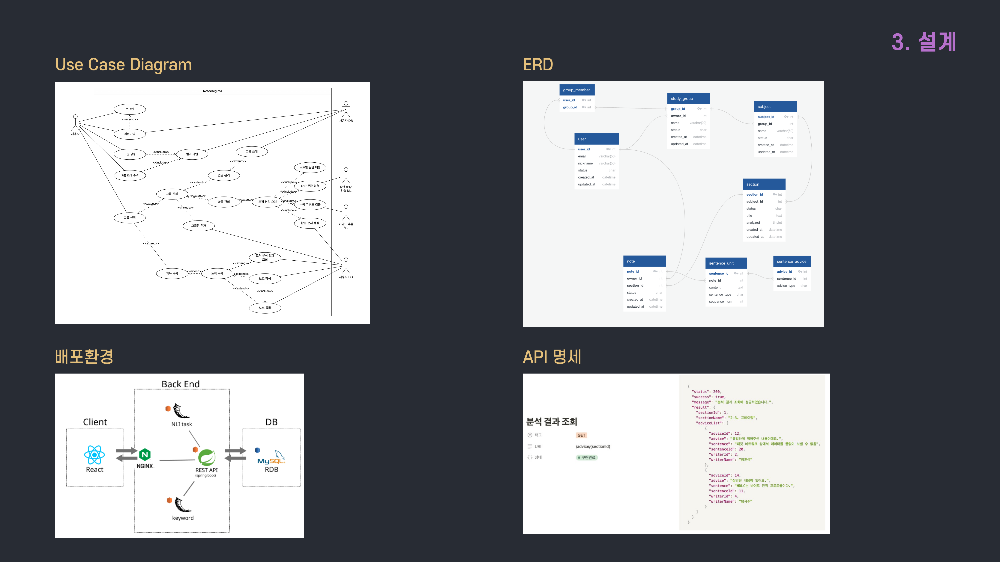
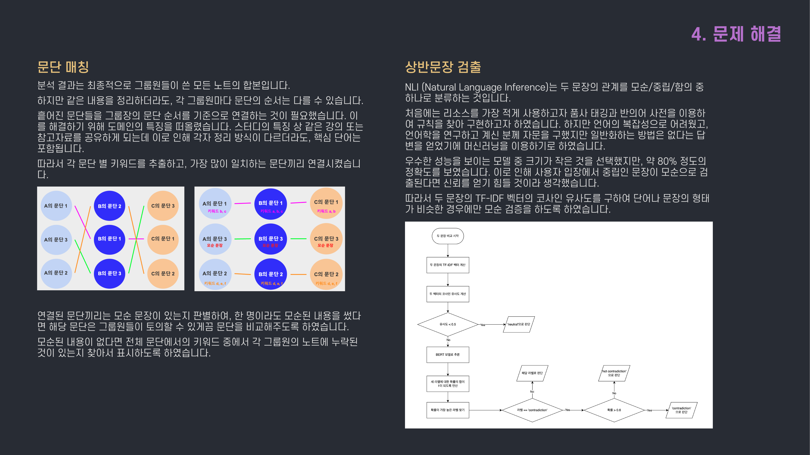
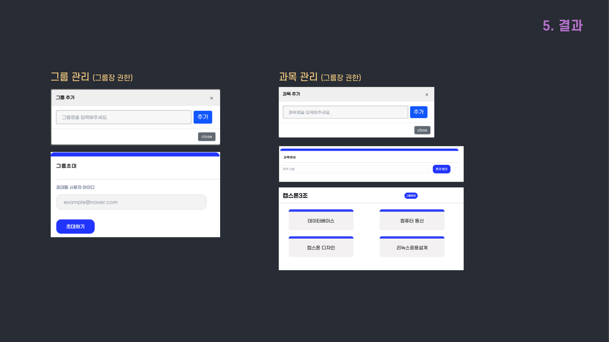
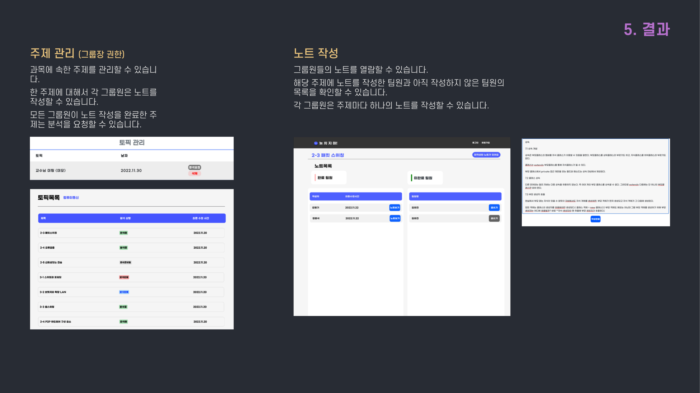
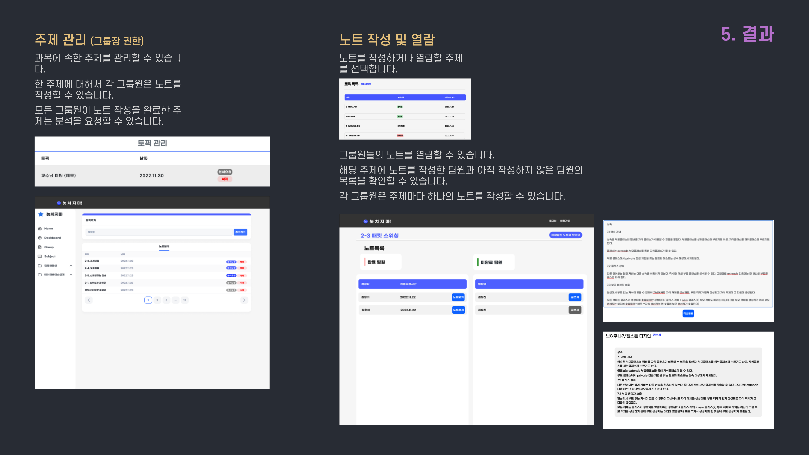
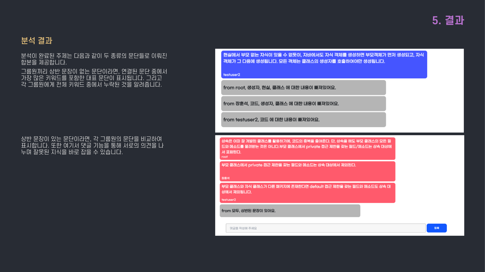

# 놋치지마 (Note-chigima)

> AI 기반 그룹 필기 비교 플랫폼 — 중앙대학교 캡스톤 프로젝트 (2022.10 ~ 2022.12)

학기 중 친구들과 강의내용을 함께 공유문서로 정리하고 스터디를 진행했습니다.
각자 공부·정리 방법이 다르다보니 하나의 문서에서 수정하는 것이 불편하게 느껴졌고,
따로 정리한다면 서로 놓치거나 틀린 부분이 있는지 비교하기 어려웠습니다.
이 부분을 자동화할 방법이 있는지에 대해 고민하여 기획한 프로젝트입니다.

## 팀 구성

| 역할 | 인원 |
|---|---|
| 백엔드 | 1 |
| 프론트엔드 | 2 |

**담당 역할** — 팀 리딩, 백엔드, 노트 비교 (자연어처리)

## 기술 스택

| 분류 | 기술 |
|---|---|
| Language | Java, Python |
| Framework | Spring Boot, Spring Security, Flask |
| ORM | Spring Data JPA |
| Cloud | AWS EC2, RDS (MySQL) |
| Docs | Swagger |
| NLI | BERT |

## 주요 기능

- **로그인 / 회원가입** — JWT 기반 인증 및 인가
- **그룹 관리** — 그룹 생성, 그룹 초대, 그룹 가입
- **과목 관리** — 과목 생성, 과목 삭제
- **주제 관리 / 분석** — 주제 생성, 분석 요청, 합본 (분석결과) 보기
- **노트 작성** — 노트 작성

## 설계

Use Case Diagram, ERD, 배포환경, API 명세

## 문제 해결

### 문단 매칭

분석 결과는 최종적으로 그룹원들의 모든 노트의 합본입니다.
하지만 같은 내용을 작성하더라도 각 그룹원마다 문단의 순서는 다를 수 있습니다.
따라서 각 문단 별 키워드를 추출하고, 가장 많이 일치하는 문단끼리 연결짓는 방식으로 매칭했습니다.

### 상반문장 검출

NLI (Natural Language Inference)는 두 문장의 관계를 모순/중립/함의 중 하나로 분류합니다.
TF-IDF 벡터의 코사인 유사도로 유사 문장만 선별한 뒤, BERT 기반 NLI 모델로 모순을 검출하여 그룹원에게 피드백을 제공했습니다.

## 결과

## 분석 결과

분석이 완료된 주제는 다음과 같이 두 종류의 문단들로 이뤄진 합본을 제공합니다.
그룹원들의 내용 병합이 된 문단이라면, 각 그룹원의 문장 중 우수한 성능을 보이는 모델을 골라 합본에 포함시켰습니다.
상반 문장이 있는 문단이라면 각 그룹원의 문단을 비교하여 모순되는 부분을 표시합니다.

